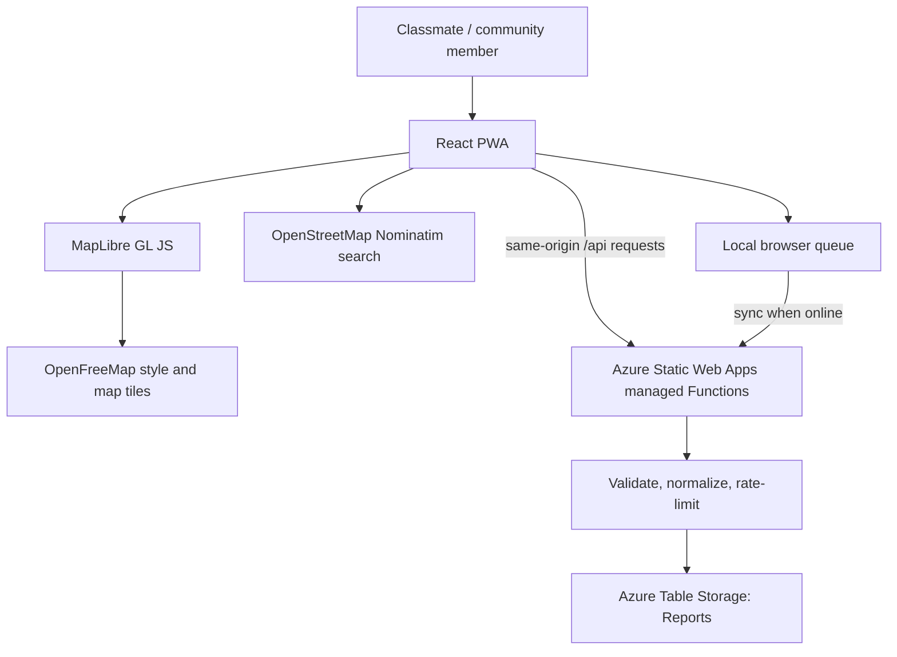

# Fallback Atlas

**Know what still works.** Fallback Atlas is an open-source, community-powered web app for reporting recent availability of mobile data, fixed broadband and power during disruptions.

> **Pilot status:** the app has a real serverless reporting API and shared-storage integration code. Shared reports are enabled only after the Azure Storage connection string is configured in the Static Web App. Until then, submissions are saved locally and clearly marked as not shared. Udaipur sample markers are examples, never live network measurements.

## What is implemented

- Global place search, an interactive MapLibre map, OpenFreeMap basemap and OpenStreetMap attribution.
- Location-aware map markers for reports with coordinates.
- Campus Wi-Fi, mobile data, fixed broadband and power reports, with three statuses, timestamps and freshness labels.
- A student-initiated Wi-Fi connection check measuring Azure endpoint response time and one public HTTPS reachability probe. It does not read Wi-Fi passwords, network names or radio signal strength automatically.
- Optional location permission to view reports within a 1 km, 3 km or 5 km radius.
- Azure Functions managed API routes: `GET /api/health`, `GET /api/reports`, and `POST /api/reports`.
- Azure Table Storage adapter with a 30-day query window, area normalization, coordinate-radius search, basic flood protection and input validation.
- Browser-local fallback and a pending-report queue when the API is not configured or unavailable.
- **Offline app shell:** after one successful online visit and service-worker installation, the site can reopen and the report form can queue a report locally. Map tiles and global place search still require internet.
- Manual refresh for shared reports; the app rechecks the API when the browser returns online.
- Automated frontend and API utility tests in GitHub Actions.

## Architecture



## Technology and open-source projects

| Layer | Project | Role |
| --- | --- | --- |
| UI | [React](https://github.com/facebook/react) | Component-based web interface |
| Maps | [MapLibre GL JS](https://github.com/maplibre/maplibre-gl-js) | Open-source interactive vector map renderer |
| Basemap | [OpenFreeMap](https://github.com/hyperknot/openfreemap) | Public vector-tile/style service; no API key for this pilot |
| Place search | [Nominatim](https://github.com/osm-search/Nominatim) + [OpenStreetMap data](https://www.openstreetmap.org/copyright) | User-submitted global location search; usage limits and attribution apply |
| Serverless API | [Azure Functions JavaScript SDK](https://github.com/Azure/azure-functions-nodejs-library) | HTTP API on the existing Static Web App |
| Storage SDK | [Azure Data Tables](https://github.com/Azure/azure-sdk-for-js/tree/main/sdk/tables/data-tables) | Persist shared reports |
| Tests | [Testing Library](https://github.com/testing-library/react-testing-library), Jest and Node's test runner | Check user flows and server-side validation |
| Crowdsourcing inspiration | [Ushahidi Platform](https://github.com/ushahidi/platform) | Reference for incident collection and mapped reports; not bundled into this app |

We avoid adding libraries without a clear role. Each open-source project has a specific purpose in the stack.

## Run locally

Requirements: Node.js 22 or a compatible version and npm.

```bash
npm install
npm start
```

Run tests and the production build:

```bash
npm test -- --watchAll=false --runInBand
node --test api/test/*.test.js
npm run build
```

## Enable shared reports in Azure

The existing GitHub workflow is configured to deploy the root `api/` folder as managed Functions. **Do not create a separate Function App or App Service for this HTTP-only pilot.**

1. In `rg-fallback-atlas-dev`, create one Azure Storage account using Standard / General-purpose v2 / locally redundant storage.
2. The API creates the `Reports` Table Storage table on first use.
3. In `swa-fallback-atlas-dev`, open **Configuration / Environment variables** and add `REPORTS_STORAGE_CONNECTION_STRING`. Put the Storage account connection string in the value field; never commit it to GitHub or React code.
4. Save, then open `/api/health` on the live website. Shared mode is ready when the response says `"mode":"shared"`.
5. Submit a test report, open the same site on a second device/browser, search the same area and press **Refresh**. The report should appear.

See [API setup](api/README.md), [cost and governance](docs/COST_AND_GOVERNANCE.md), [class demo guide](docs/CLASS_DEMO_GUIDE.md) and [architecture](docs/ARCHITECTURE.md).

**Cost note:** Static Web Apps Free includes managed Functions APIs within plan limits. Azure Table Storage is billed separately according to storage and transactions and consumes Azure for Students credit. Do not treat it as free; keep the data small, deallocate the workshop VM and monitor Cost Management. If you cannot accept any additional Azure usage, leave the backend unconfigured and keep local-only mode.

## Safety and data limitations

- Reports are community-submitted, not official utility telemetry.
- Evidence freshness is a signal, not proof of correctness or independent verification.
- No account, phone number, name or browser geolocation is required.
- Nominatim's public service is rate-limited at the application level (maximum one request per second) and suitable only for moderate, user-triggered search. Browser cache cannot enforce a global rate limit for all visitors. Read the [Nominatim usage policy](https://operations.osmfoundation.org/policies/nominatim/).
- Offline mode caches only the same-origin app shell. Map tiles, geocoding and shared reports still require an internet connection.

## Roadmap

1. Configure shared storage and test across two devices.
2. Run a 5–8 person campus/hostel usability study using the pilot plan.
3. Add report expiry/retention cleanup and moderation before a wider public launch.
4. Add shared geocoding caching/rate limiting if traffic grows.

## Attribution and license

Map rendering uses MapLibre GL JS (BSD-3-Clause), OpenFreeMap (MIT software) and OpenStreetMap data (ODbL). Nominatim's public server usage policy still applies. The Fallback Atlas application is released under the MIT License; see [LICENSE](LICENSE).
