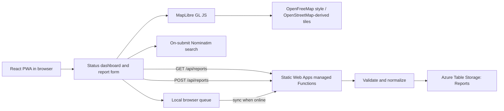

# Fallback Atlas architecture

## Data flow

## Trust boundaries

- Browser inputs are untrusted; the API validates them again.
- Local-only reports are not shared.
- The Storage connection string stays in server-side Azure environment settings.
- Geocoder and map services receive location queries / map tile requests. Do not submit sensitive addresses.
- Community reports are observations, not official service status. Freshness helps interpret age but does not prove truth.

## Storage record

A report stores an opaque ID, normalized area key, area label, service, status, short note, server-created time, observed time and optional coordinates from the selected map view. No user identity is collected.

## Design decisions

- Use the existing Static Web App's managed Functions API rather than a separate Function App or App Service.
- Keep anonymous reporting for the small classroom pilot, with input checks and a per-area submission threshold.
- Use Table Storage rather than a continuously running database server.
- Keep map tiles/geocoding separate from the report API.
- Keep demo markers visibly separate from real community submissions.
